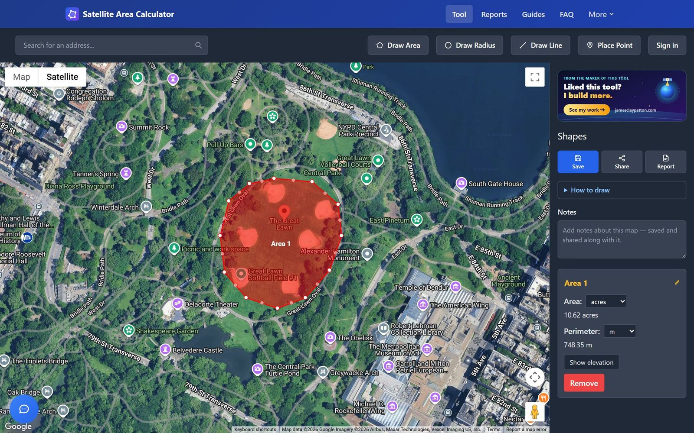
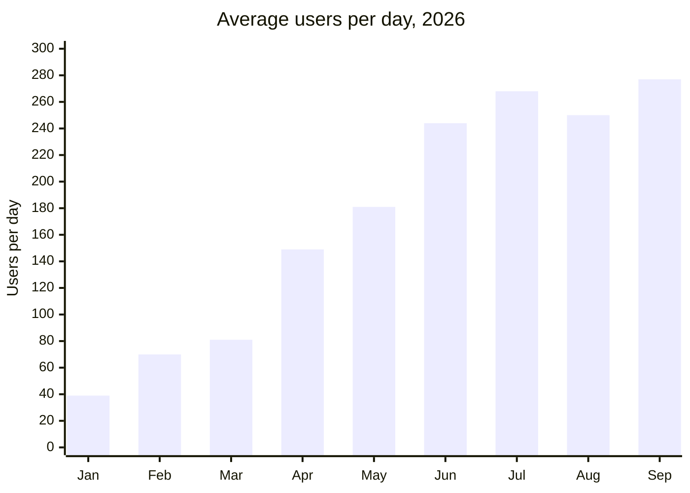
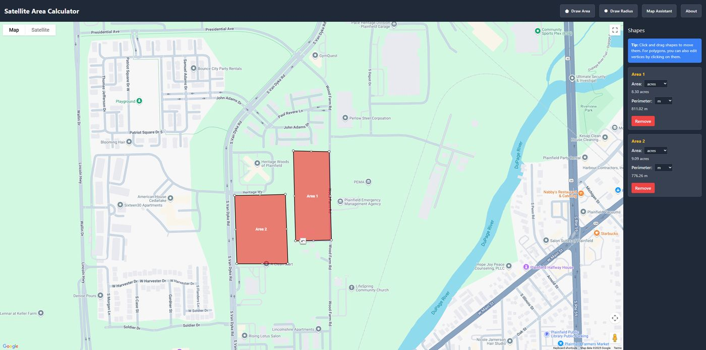
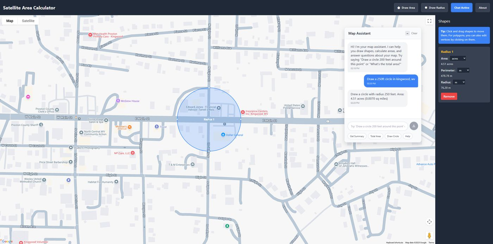
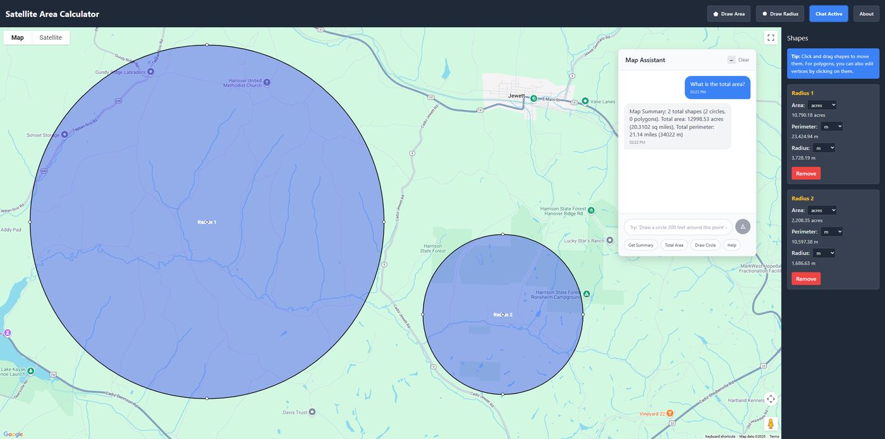
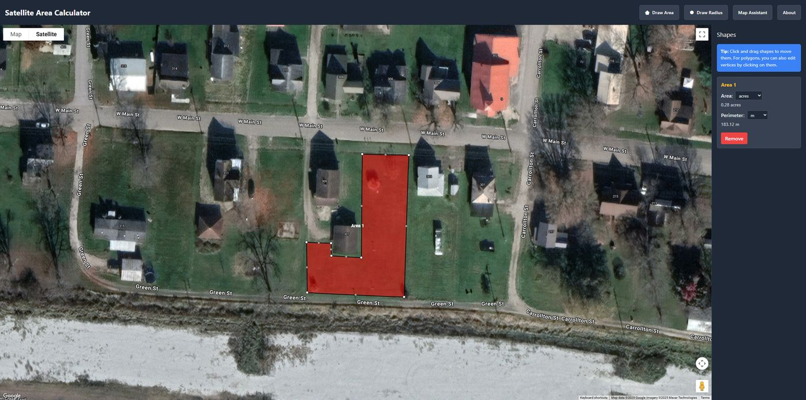
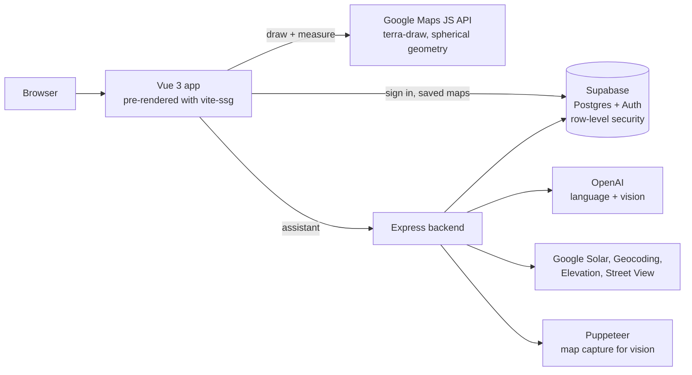

# Satellite Area Calculator

**Draw on satellite imagery, get the area and distance.**

Free, no ads, and no sign-up needed to measure. Live at **[satellitearea.com](https://satellitearea.com)**.

> This repo is a public overview of how the site works. The code itself lives in a private repo.

  

I'm one developer and have been building this since June 2025. I made it to be easier to use than the area tools already out there, and to have no ads. Roofers, fence builders, landscapers, farmers and contractors now use it every day to measure their jobs.

---

## By the numbers

| | |
|---|---|
| **38,700+** | users in 2026 so far (Jan 1 to Sep 29) |
| **15x** | the users of all of 2025 (about 2,500) |
| **68,400** | page views in 2026 so far |
| **270+** | users a day over the last 30 days |
| **~9 in 10** | users arrive from a search engine |
| **620** | signed-up accounts, with **22%** coming back for another visit |
| **513** | maps saved |

| Where users come from (2026) | Users |
|---|---:|
| Google search | 28,633 |
| Direct | 4,074 |
| Bing search | 3,767 |
| DuckDuckGo | 836 |
| AI assistants (ChatGPT, Copilot, Perplexity) | 720 |
| Yahoo search | 548 |

Traffic numbers come from Google Analytics (snapshot of Sep 29, 2026). Account and map numbers come from the site's own admin dashboard, which leaves out my own activity.

---

## What it does

**Measure.** Draw polygons for area, lines for distance, circles for radius and points for elevation. The numbers update as you draw, in acres, square feet, square meters, hectares, square miles and square kilometers, with perimeter. For lines it shows both the straight-line distance and the length of the path.

**Find the place.** Search for an address or place, or type what you want and the built-in assistant navigates, draws, measures and converts units for you ("draw a 2-acre square around the barn", "how big is this roof?").

**Elevation.** Draw a line and get an elevation profile with total climb, descent and the steepest grade.

**Save and share.** Signed-in users keep their maps on a dashboard, duplicate them, and share a read-only link. Maps export as GeoJSON and KML.

**Concept images.** Generate a concept image of a site from the map view or a Street View angle.

### Who uses it

Roofers and solar installers sizing roofs, fence builders and landscapers pricing jobs, farmers measuring fields, real estate agents, planners, researchers, and anyone who needs a measurement from above.

  
  

  
  

<em>Adjacent plots, a planning radius, environmental zones and a single property (earlier version of the interface).</em>

---

## How it works

**Frontend.** Vue 3 with Pinia and Tailwind, built with Vite. Drawing uses [terra-draw](https://github.com/JamesLMilner/terra-draw) through its Google Maps adapter, which gave consistent polygon, line and circle editing on top of the Maps JavaScript API. Measurements use the Maps geometry library's spherical functions instead of flat-map math, so a field in Minnesota and a field in Texas both come out right.

**Pre-rendered, not a single-page app.** Every route is pre-rendered with vite-ssg, so the home page, the industry landing pages and the guides are plain HTML for search engines. Routes are plain data and pages load with dynamic imports, so the home page doesn't pull every guide into its bundle. This is most of why search traffic grew 15x in a year.

**Backend.** An Express service on Render. It runs the assistant (OpenAI, with the map state and already-geocoded places passed in so the model only has to produce a structured command), map snapshots with Puppeteer so the assistant can read the satellite image, concept images through Replicate, the contact form through Resend, and a small admin dashboard with usage, growth and assistant logs.

**Data.** Supabase for sign-in (Google, X and Microsoft) and Postgres, with row-level security on every table: profiles, maps, generations, credits, assistant logs and feedback. The frontend talks to Supabase directly for maps. Anything that needs a server-side key goes through the backend with the user's token.

**Tests.** The pure modules (shapes, geometry, formatting, map export, elevation smoothing) have Node test files next to them.

| Part | Built with |
|---|---|
| Frontend | Vue 3, Pinia, Vue Router, Tailwind CSS, Vite, vite-ssg |
| Drawing and maps | terra-draw, Google Maps JavaScript API, Places, Geocoding, Elevation, Street View, Solar API |
| Backend | Node.js, Express, Puppeteer |
| Data and auth | Supabase (Postgres, Auth, row-level security) |
| AI and services | OpenAI, Replicate, Resend |
| Hosting | Netlify (frontend), Render (backend) |

---

## The process

**June to August 2025: a simple tool that's easy to use.** The first version was a single map where you draw a polygon and read the acreage. Within a few weeks I added the AI assistant, because typing "the field behind the church on Main St" was faster than finding it by hand.

**Late 2025: make the drawing solid.** I rewrote the drawing layer on terra-draw so you can have many shapes at once, drag corners and switch tools without losing work. Much of the work was fixing small problems, like squares that came out the wrong shape away from the equator, or the assistant drawing a triangle in Texas when it couldn't find an address.

**Early 2026: accounts, sharing and search.** Supabase brought sign-in, saved maps and share links. The home page became a real landing page, every route was pre-rendered, and I wrote guides answering the questions people search for ("how to measure property acreage", "lot size from an address"). Daily users went from 39 in January to 149 in April.

**Mid 2026: build for the people who use it most.** Roofers, fence builders, landscapers and contractors measure jobs so they can price them. So I added exact roof area from the Solar API, elevation profiles, landing pages for each trade, and retention tracking to see who comes back.

### The hard parts

- **Accurate math on a round planet.** Area and distance use spherical geometry, and squares and circles drawn by the assistant scale latitude and longitude separately so they keep their shape anywhere on Earth.
- **An assistant that does what you mean.** The model gets the map state and places that are already geocoded, and only has to return a structured command. Every command and its result is logged with a thumbs up or down from the user, which is how the prompt and command grammar got tuned.
- **A drawing interface that stays out of the way.** Areas, lines, circles and points all edit the same way, on desktop and on phones.
- **Pages that search engines can read.** Moving from a single-page app to pre-rendered HTML for every page.

### Design decisions

- **Free, no ads, and no sign-up to measure.** The core tool works without an account. Accounts only unlock saving and sharing, so a visitor's first experience is the tool itself.
- **Elevation data needs smoothing.** Google's elevation samples wobble by a meter or two on flat ground. Without a moving average and a climb threshold, a flat field reports fake climbs and slopes. The start and end heights stay exact; only the middle is smoothed.
- **Privacy in the database.** Saved maps are private by default, and Postgres row-level security enforces it, not checks in the frontend.
- **Measure what matters.** The admin Growth tab tracks weekly signups and returning users, so I decide what to build from real usage instead of guesses.

---

## Links

- Live site: [satellitearea.com](https://satellitearea.com)
- Portfolio write-up: [jamesclaypatton.com/projects/satellite-area-calculator](https://jamesclaypatton.com/projects/satellite-area-calculator)

## About me

I'm James Patton. I design and build web tools on my own. See more of my work at [jamesclaypatton.com](https://jamesclaypatton.com).

© 2025–2026 James Patton. All rights reserved.
